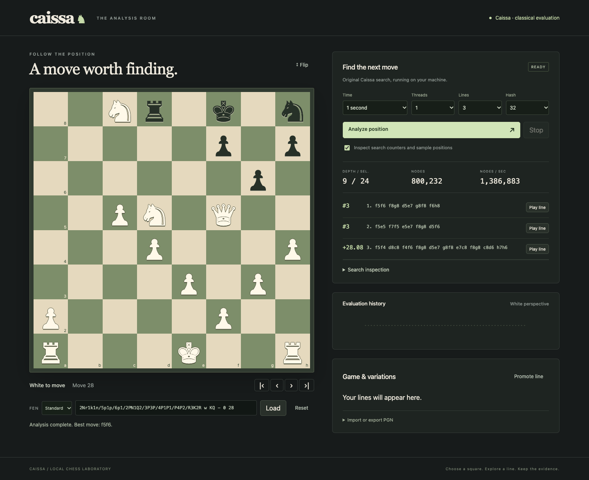

# Caissa

An original C++23 UCI chess engine for standard chess and Chess960. Analyze a
position in the offline browser board, play the engine's suggested lines, and
export your variations as PGN.

[macOS arm64](https://github.com/Aneesh495/caissa/releases/download/v0.1.0/caissa-0.1.0-macos-arm64.tar.gz) · [Linux x86-64](https://github.com/Aneesh495/caissa/releases/download/v0.1.0/caissa-0.1.0-linux-x86_64.tar.gz) · [Two-minute demo](docs/DEMO.md) · [Release notes and checksums](https://github.com/Aneesh495/caissa/releases/tag/v0.1.0)



## Run it

Extract the release and add `build/caissa` to a UCI-compatible chess GUI.
For the browser board, open a terminal in the extracted directory and run
the following command with Node.js 24 installed.

```sh
node dist/analysis-service/server.js
```

Open [the local board](http://127.0.0.1:8765). It supports FEN and PGN import,
search cancellation, variation playback, and optional search inspection.
See the [quick start](docs/QUICKSTART.md) for UCI and neural settings.

## Playing strength

The default classical engine played **192 independently replayed games** at
50 ms per move, with both colors played from each opening.

| Stockfish 19 opponent | Caissa W-D-L | Relative Elo | 95% interval |
|---|---:|---:|---:|
| Unrestricted | 15-1-80 | −286 | −394 to −206 |
| Skill Level 0 | 93-0-3 | +597 | +442 to unbounded |

Four of the 15 wins against unrestricted Stockfish were time forfeits.
Scoring those four as Caissa losses gives −346 relative Elo with a 95%
interval of −470 to −261. The figures describe these match conditions.
[Benchmark setup and replay](docs/RELEASE_STRENGTH.md)

## How it works

- Bitboard move generation handles checks, pins, en passant, and Chess960 castling. Reversible state tracks the history needed for draw decisions. [Move generation](src/movegen.cpp) · [Position state](src/position.cpp)
- Iterative principal variation search uses quiescence, a transposition table, and bounded root workers. The browser can show completed-depth work and sampled search positions from the native engine. [Search](src/search.cpp) · [Search inspection](docs/notes/search-inspection.md)
- The experimental evaluator updates two king-relative accumulators as pieces move. Three training seeds used data from 229,582 original self-play games. The selected model lost its matched strength comparison, so the release defaults to classical evaluation. [Neural inference](src/network.cpp) · [Model card](docs/MODEL_CARD.md)
- The match arena pairs both colors from each opening and independently replays games and result statistics. [Arena](arena/run.py) · [Architecture](docs/ARCHITECTURE.md)

## Build from source

Use a C++23 compiler, CMake 3.25 or newer, and Ninja.

```sh
make test
./build/caissa --perft 4  # 197281
```

For the local board, use Node.js 24 and run `npm ci --ignore-scripts` followed
by `make demo`. For the experiment tools, use uv and Python 3.12, then run
`make bootstrap` and `make lab-test`.

## Research record

The product release is separate from the original research acceptance.
The neural gain requirement failed, the multicore sample is partial, and
some historical raw artifacts were retired. The detailed results, negative
findings, and reproduction instructions remain available.
[Build status](docs/BUILD_STATUS.md) · [Findings](docs/FINDINGS.md) · [Reproduction](docs/REPRODUCIBILITY.md) · [Artifact retention](docs/ARTIFACT_RETENTION.md)
