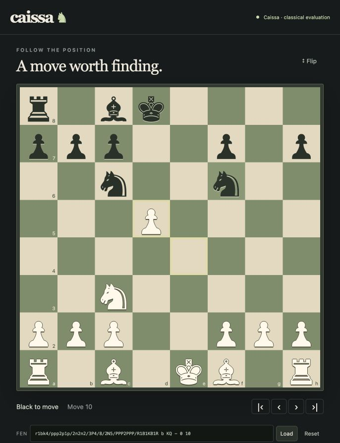

# Caissa

An original C++23 chess engine with incremental neural evaluation, a paired-match laboratory and a local analysis board.

**Development build. Full acceptance is incomplete. No absolute Elo rating or Stockfish-level strength is established.** Classical evaluation is the default because the selected neural evaluator lost its full matched comparison. See [build status](docs/BUILD_STATUS.md) and [findings](docs/FINDINGS.md).



## Run

Native prerequisites: C++23 compiler, CMake 3.25 or newer and Ninja. The laboratory uses uv, Python 3.12 and Node 24. Apple arm64 and Ubuntu x86-64 builds run in [CI](https://github.com/Aneesh495/caissa/actions/workflows/ci.yml).

```sh
make bootstrap
make test
make lab-test
make demo
```

Open `http://127.0.0.1:8765`. Import a FEN or PGN, select a legal move, analyze, cancel, edit a variation and export the actual tree. The native engine needs no Python, network, reference engine or downloaded weights to play.

For a bounded command-line example:

```sh
./build/caissa --perft 4
./build/caissa --search 4
./build/caissa
```

The first command prints `197281`. The last command starts UCI:

```text
uci
isready
position startpos moves e2e4 e7e5
go nodes 10000
quit
```

## Mechanisms

- [Legal generation](src/movegen.cpp): check and pin filtering, independent mailbox comparison, en passant and overlapping Chess960 castling.
- [Search](src/search.cpp): iterative PVS, aspiration, quiescence, selective heuristics with off switches, bounded root workers and legal interrupted-search fallback.
- [Position identity](src/position.cpp): exact reversible state, history-dependent draw decisions and separate safe search keys.
- [Neural inference](src/network.cpp): original two-perspective king buckets, sparse accumulator updates, two nonlinear dense stages, scalar/NEON/AVX2 arithmetic contracts.
- [Training](training/train.py): original selfplay labels, functional-input split screening, three independent seeds, validation selection and resumable optimizer/RNG state.
- [Arena](arena/run.py): color-reversed openings, immutable inputs, independent legality, failure accounting, paired recovery and opening-cluster uncertainty.
- [Analysis service](analysis-service/server.ts): loopback token/origin boundary, native-process budgets, stale-request cancellation and bounded output.

See the [architecture and editable diagrams](docs/ARCHITECTURE.md), [execution walkthroughs](docs/WALKTHROUGHS.md), [technical notes](docs/notes/) and [decisions](docs/adr/README.md).

## Executed checks

| Check | Observed result | Scope |
|---|---|---|
| Full data reconstruction | 229582 completed original games; 10578434 distinct training inputs; every exported row independently rebuilt | [Data domain passed](results/full-data-2026-10-25/README.md); strength remains pending |
| Original learning | Three seeds completed 20000 updates each; all 240 checkpoints independently evaluated | [Validation-only selection](docs/MODEL_CARD.md); no test access or Elo conclusion |
| Rules | 20 perft fixtures; 100000-position differential campaigns with zero disagreements | Development executables |
| State restoration | 1000000 seeded transitions per Release/ASan+UBSan/TSan mode, independently replayed | [Selected q4096 network, both platforms](results/precision-v4-followup-2026-10-25/README.md) |
| Protocol | 10000 adversarial sequences; recorded stop p99 below 50 ms | Frozen local host/load |
| Integer inference | 100000 probes, bit-identical scalar/native/reference outputs | [Selected q4096 encoding](docs/notes/precision-v4.md), both platforms |
| Float/integer error | Maximum 10.395 cp, mean 1.108 cp, unchanged limit 32 cp | Same selected float checkpoint; original q1024 failure retained |
| Warm Stockfish 19 unrestricted | 0 wins, 0 draws, 48 losses | 20 ms/move, small paired diagnostic |
| Full original neural contribution | 1274W/746D/1980L; -61.97 Elo, 95% interval [-71.25,-52.87] | [4000 games independently replayed](results/full-neural-v3-2026-10-25/README.md); required positive gain failed |
| Larger neural pilot versus classical | 4 wins, 8 draws, 84 losses | 2000 nodes/move, diagnostic data split |

These checks establish specific behavior. The data-domain pass does not certify a positive learned contribution, the full external campaign or a release. Opponent strength settings are not a calibrated absolute rating pool.

The [model card](docs/MODEL_CARD.md) records the completed three-seed training, validation-only selection, original failed encoding and subsequent precision experiment. It also gives the explicit ten-percent UCI setting required by the selected model.

[Reproduction](docs/REPRODUCIBILITY.md) explains the bounded demo and clean-checkout verifier. [Experiment protocol](docs/EXPERIMENT_PLAN.md), [artifact contracts](docs/ARTIFACT_FORMAT.md), [limitations](docs/LIMITATIONS.md), [recovery](docs/RECOVERY.md) and [dependency provenance](docs/DEPENDENCIES.md) define the practical boundaries.

[Browser validation and keyboard recovery](docs/UI_VALIDATION.md) records the fresh-origin, constrained-viewport and real service-restart checks.
