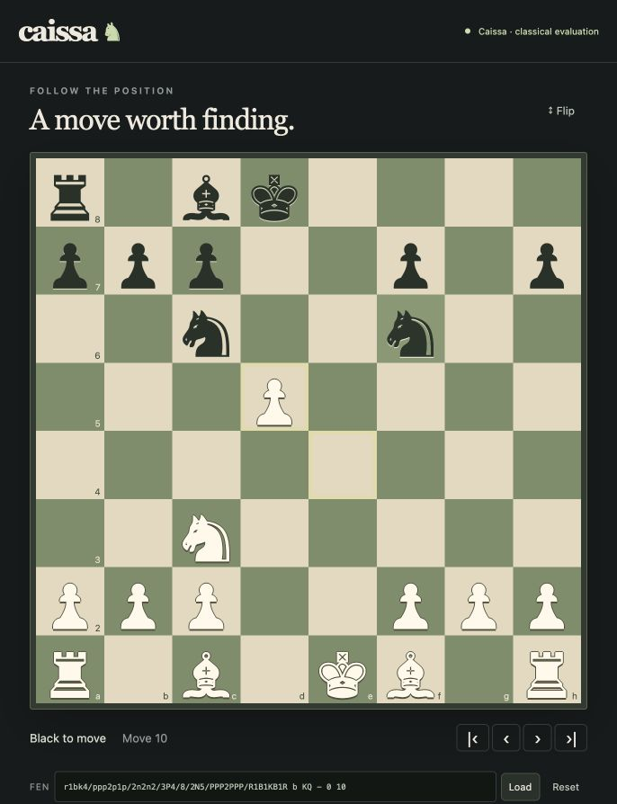

# Caissa

An original C++23 UCI chess engine for standard chess and Chess960, with a local analysis board, an experimental incremental neural evaluator and a paired-match laboratory.

[Download Caissa v0.1.0](https://github.com/Aneesh495/caissa/releases/tag/v0.1.0) for macOS arm64 or Linux x86-64. Each archive contains the offline engine, the analysis board and an optional original network. Classical evaluation is the default because it won the evaluator comparison. See the [model card](docs/MODEL_CARD.md).



## Play or analyze

Point a UCI-compatible chess GUI at `build/caissa` in the extracted release.
To open the local board, run `node dist/analysis-service/server.js` with Node.js
24 from that directory, then open [the local board](http://127.0.0.1:8765).
Import a FEN or PGN, analyze and cancel searches, and edit and export variations.
See the [quick start](docs/QUICKSTART.md) for command-line and neural options.

## Build from source

Use a C++23 compiler, CMake 3.25 or newer and Ninja. The engine needs no
Python, network access, reference engine or downloaded weights to play.

```sh
make test
./build/caissa --perft 4
```

Perft prints `197281`. For the board, install the pinned JavaScript build
dependencies with Node.js 24 and start the local service.

```sh
npm ci --ignore-scripts
make demo
```

The experiment tools use uv and Python 3.12. Run `make bootstrap` and
`make lab-test` to exercise the local laboratory.

## Playing strength

Caissa v0.1.0 played 192 games at 50 ms per move with both colors per opening.
Against unrestricted Stockfish 19, it scored **15 wins, 1 draw and 80 losses**,
for **−286 relative Elo** with a 95% interval of **[−394, −206]**. The 15 wins
include four Stockfish time forfeits. Against Stockfish 19 at Skill Level 0, it
scored **93 wins and 3 losses**, for **+597 relative Elo** with a 95% lower
endpoint of **+442** and an unbounded upper endpoint. See the [match setup,
forfeit sensitivity and replay instructions](docs/RELEASE_STRENGTH.md).

## Mechanisms

- [Legal generation](src/movegen.cpp): check and pin filtering, independent mailbox comparison, en passant and overlapping Chess960 castling.
- [Search](src/search.cpp): iterative PVS, aspiration, quiescence, selective heuristics with off switches, bounded root workers and legal interrupted-search fallback.
- [Position identity](src/position.cpp): exact reversible state, history-dependent draw decisions and separate safe search keys.
- [Neural inference](src/network.cpp): original two-perspective king buckets, sparse accumulator updates, two nonlinear dense stages, scalar/NEON/AVX2 arithmetic contracts.
- [Training](training/train.py): original selfplay labels, functional-input split screening, three independent seeds, validation selection and resumable optimizer/RNG state.
- [Arena](arena/run.py): color-reversed openings, immutable inputs, independent legality, failure accounting, paired recovery and opening-cluster uncertainty.
- [Analysis service](analysis-service/server.ts): loopback token/origin boundary, native-process budgets, stale-request cancellation and bounded output.

See the [architecture and editable diagrams](docs/ARCHITECTURE.md), [execution walkthroughs](docs/WALKTHROUGHS.md), [technical notes](docs/notes/) and [decisions](docs/adr/README.md).

## Historical research results

| Check | Observed result | Scope |
|---|---|---|
| Full data and learning audit | 229582 completed original games; 10578434 distinct training inputs; every exported row rebuilt and all 240 original checkpoints independently evaluated | [Full G07 join passed](results/g07-full-audit-2026-10-26/README.md); final source binding and portable bulk remain pending |
| Original learning | Three seeds completed 20000 updates each; all 240 checkpoints independently evaluated | [Validation-only selection](docs/MODEL_CARD.md); no test access or Elo conclusion |
| Rules | 20 perft fixtures; 100000-position differential campaigns with zero disagreements | Development executables |
| State restoration | 1000000 seeded transitions per Release/ASan+UBSan/TSan mode, independently replayed | [Selected q4096 network, both platforms](results/precision-v4-followup-2026-10-25/README.md) |
| Protocol | 10000 adversarial sequences; recorded stop p99 below 50 ms | Frozen local host/load |
| Integer inference | 100000 probes, bit-identical scalar/native/reference outputs | [Selected q4096 encoding](docs/notes/precision-v4.md), both platforms |
| Float/integer error | Maximum 10.395 cp, mean 1.108 cp, unchanged limit 32 cp | Same selected float checkpoint; original q1024 failure retained |
| Warm Stockfish 19 unrestricted | 0 wins, 0 draws, 48 losses | 20 ms/move, small paired diagnostic |
| Full original neural contribution | 1274W/746D/1980L; -61.97 Elo, 95% interval [-71.25,-52.87] | [4000 games independently replayed](results/full-neural-v3-2026-10-25/README.md); required positive gain failed |
| Full original external comparison | 2000 games across three settings; unrestricted Stockfish 19 subset: -392.39 relative Elo, 95% interval [-438.13,-353.45] | [Original q1024 candidate](results/full-external-v3-2026-10-25/README.md); no absolute rating |
| New q4096/deferred neural comparison | 4000 scheduled attempts, 3997 finished games, three unfinished at the original 512-ply ceiling; independent acceptance failed | [Failure preserved](results/neural-v4-failure-2026-10-26); completed-game diagnostic -63.86 relative Elo versus classical, 95% interval [-73.80,-54.07]; not a certified full sample |
| New q4096/deferred external comparison | All 2000 games independently replayed; unrestricted Stockfish 19 subset: 56W/2D/608L, -411.50 relative Elo, 95% interval [-460.14,-370.68] | [Frozen v4 actor](results/external-v4-2026-10-26); 100 ms, one thread, 16 MiB; no absolute rating |
| Selected v4 runtime performance | 640 timed searches, 4581 memory observations, 2000 readiness samples and 16 independent scalar/native searches | [Full performance sample passed](results/performance-v4-2026-10-26/README.md); 1/2/4/8 threads, final binding pending; no Elo inference |
| Larger neural pilot versus classical | 4 wins, 8 draws, 84 losses | 2000 nodes/move, diagnostic data split |

The original research acceptance remains incomplete. The failed neural gain,
partial multicore sample and unavailable historical artifacts are recorded in
the [build status](docs/BUILD_STATUS.md), [findings](docs/FINDINGS.md) and
[retention record](docs/ARTIFACT_RETENTION.md).

The [model card](docs/MODEL_CARD.md) records the completed three-seed training, validation-only selection, original failed encoding and subsequent precision experiment. It also gives the explicit ten-percent UCI setting required by the selected model.

[Reproduction](docs/REPRODUCIBILITY.md) explains the bounded demo and clean-checkout verifier. [Experiment protocol](docs/EXPERIMENT_PLAN.md), [artifact contracts](docs/ARTIFACT_FORMAT.md), [limitations](docs/LIMITATIONS.md), [recovery](docs/RECOVERY.md) and [dependency provenance](docs/DEPENDENCIES.md) define the practical boundaries.

[Browser validation and keyboard recovery](docs/UI_VALIDATION.md) records the fresh-origin, constrained-viewport and real service-restart checks.
