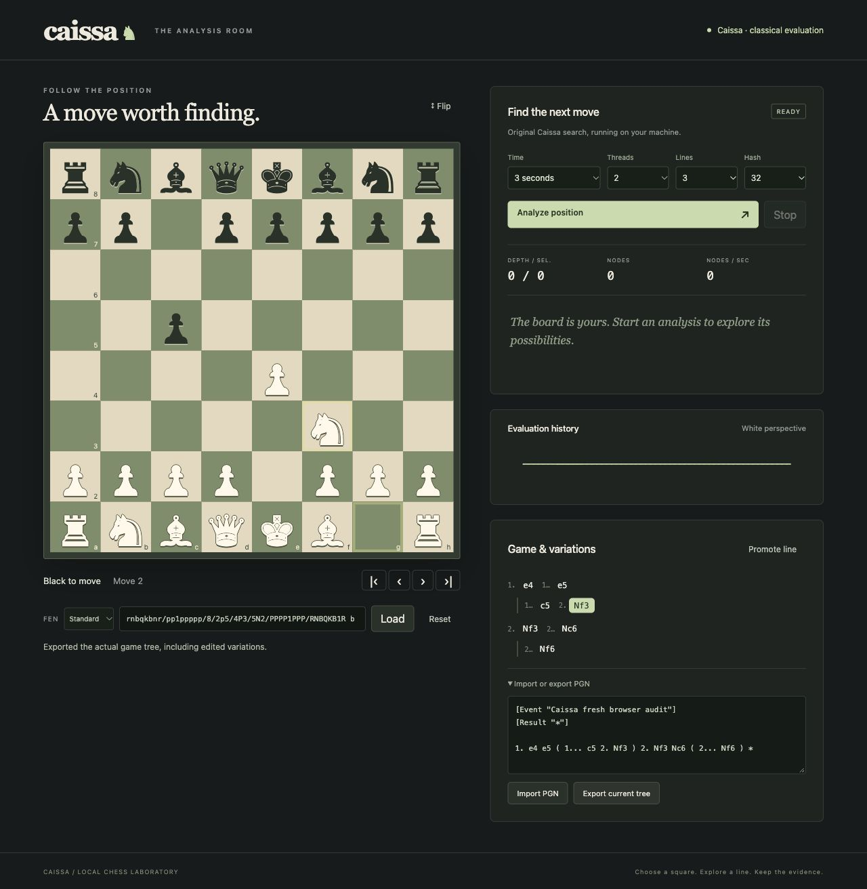

# Browser validation

The observed run used a fresh origin on port 8766 to preserve an existing game on port 8765. The original native engine imported a PGN with a main line and variation. Keyboard square selection created `1. e4 c5`, and a 390 by 844 viewport added `2. Nf3`. The edited variation survived a real service restart and exported identically. Python-chess independently replayed the exported variation and every captured principal variation.

A move originally detached the focused square during board reconstruction. The corrected path restores focus to the destination unless the user moved to another control while the request was pending. After the narrow-screen `g1f3`, the focused accessibility element was `f3 white knight`. The page measured 390 CSS pixels wide with no horizontal overflow. The viewport override was reset afterward.

A 30-second native analysis was observed searching, then Escape restored READY with Stop disabled and Analyze enabled. The last completed lines remained. Invalid FEN input produced a visible error. The separate real service integration test checked native parsing/search, cancellation cleanup, malformed input, and token/origin rejection. The roughly 602 ms observed UI transition includes automation and accessibility capture. It is not the native stop-latency endpoint.

[Raw observations, exact PGN, accessibility captures and source hashes](../results/ui-keyboard-2026-10-22/OBSERVATIONS.json) retain this run. It is development evidence; the final release must repeat source-bound validation after relevant changes.

[Constrained viewport screenshot](images/keyboard-narrow.png)
